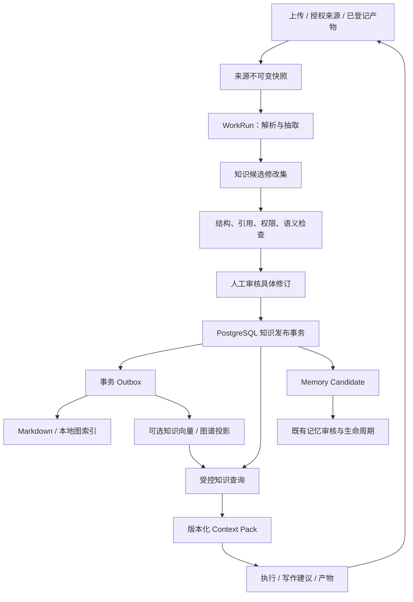

# 第二大脑知识子系统设计分方案

**方案编号**：SB-01  
**版本**：v1.0  
**日期**：2026-10-06（Asia/Shanghai；调研基线 2026-10-05）  
**状态**：实施中；SB0–SB4 核心工程及隔离验证已完成，SB4 记忆桥接按第 9.1 节采用 export-only 提案降级。生产运维门禁、真实用户试点、人工质量金标和 7 天观察待验收；正式上下文注入、原生记忆桥接和周期调度均未启用。详见 [SB0/SB1](SECOND-BRAIN-PHASE-SB0-SB1.md)、[SB2](SECOND-BRAIN-PHASE-SB2.md)、[SB3](SECOND-BRAIN-PHASE-SB3.md)、[SB4 成果与运维恢复](SECOND-BRAIN-PHASE-SB4.md)、[受控试点准备与验收](SECOND-BRAIN-PILOT-PLAN.md)及[实际配置记录](SECOND-BRAIN-PILOT-CONFIGURATION.md)（2026-10-07：基础配置预检及[空基线恢复](SECOND-BRAIN-PILOT-READINESS.md)通过，[30 份来源入库及恢复](SECOND-BRAIN-PILOT-INTAKE.md)完成、候选待审核，真实观察尚未开始）  
**所属总体方案**：[系统闭环补强总体方案](SYSTEM-CLOSURE-MASTER-PLAN.md)  
**产品设计入口**：[DESIGN.md](../DESIGN.md)  
**跨域约束**：[记忆与 Agent Team 协同总纲](SYSTEM-COORDINATED-OPTIMIZATION-PLAN.md)

## 1. 可行性与设计结论

可行。将 Second Brain OS 的“来源保留、概念增量积累、双向联系、矛盾留痕、周期维护”引入现有知识域，形成资料进入、知识审核、检索使用、成果回流的闭环。复用 agent-system 的 FastAPI、Vue 3/Element Plus、Context Pack、WorkRun、Artifact 与长期记忆审核机制。

本分方案采用以下决定：

1. **新增知识编译与治理能力**：把原始资料转成可版本化的来源、实体、概念、综合页面，先形成候选修改集，再审核发布。
2. **知识与记忆分别治理**：知识回答“材料说了什么、有哪些证据和争议”；长期记忆回答“关于用户、项目、智能体，哪些规则和事实已经确认”。知识审核不会自动授予记忆权威。
3. **新知识域以 PostgreSQL 为权威**：原始文件是不可变来源附件；Markdown、图谱和向量都是派生投影。现有外部 Obsidian 笔记保持其原有文件权威，只有明确导入的快照进入新知识域。
4. **现有正文权威不变**：论文、PPT、图表和正式交付仍由原领域管理；知识页不能直接覆盖写作正文或把外部实验结论变成正式证据。
5. **渐进接入**：先交付一个项目内“导入一份资料 → 审核 → 引用回答”的可验收流程，再扩展维护、知识上下文和可选语义索引。

实现条件不是增加更多 Agent，而是落实版本、引用、状态机和权限检查。主要工作量在现有系统的边界适配、可靠提交和产品界面，核心抽取流程可由既有模型执行能力承载。

## 2. 现有基线与证据

### 2.1 本次核对范围

以下结论来自 2026-10-05 工作区的静态代码和文档阅读，含已有未提交变更。未连接生产数据库，未验证线上开关、容量或模型效果。历史方案中的已完成阶段及数量不作为本次运行验收结果。

| 能力 | 已有代码入口 | 本方案复用与补齐 |
| --- | --- | --- |
| Obsidian 浏览、树、搜索、邻接关系 | [knowledge_manager.py](../backend/knowledge_manager.py)、[knowledge.py](../backend/routers/knowledge.py) | 保留旧读取适配；新增按稳定 ID 和修订读取的受控知识服务 |
| 知识产品界面 | [Knowledge.vue](../frontend-v2/src/views/Knowledge.vue)、[路由](../frontend-v2/src/router/index.ts)、[openclaw.ts](../frontend-v2/src/api/openclaw.ts) | 扩展 `/knowledge`，复用当前实际调用链，不假设所有历史 knowledge API 都在使用 |
| 可选 LightRAG / KAG 适配 | [knowledge_stack_manager.py](../backend/knowledge_stack_manager.py)、[knowledge_stack.py](../backend/routers/knowledge_stack.py) | 保持可选；受控知识导出必须另加作用域、版本、撤回契约 |
| 知识进入上下文 | [context_retrieval_service.py](../backend/services/context_retrieval_service.py) | 已有 `_search_knowledge` 和 `knowledge:<node_id>`；新增受控页适配和修订快照 |
| 记忆生命周期与检索 | [memory_lifecycle_service.py](../backend/services/memory_lifecycle_service.py)、[memory_vector_service.py](../backend/services/memory_vector_service.py) | 保留原权威、作用域、排序及发布门禁 |
| 执行持久化 | [work_run_service.py](../backend/services/work_run_service.py)、[command_center_repository.py](../backend/repositories/command_center_repository.py) | 挂接入库执行、重试和租约；不重建独立任务调度系统 |
| 产物读取与哈希校验 | [mission_artifact_reader.py](../backend/services/mission_artifact_reader.py) | 复用路径及哈希约束思路；适配其当前大小上限，不能直接视为通用大文件服务 |
| 写作权威与候选修改 | [DESIGN.md](../DESIGN.md)、[structured_document_service.py](../backend/services/structured_document_service.py) | 仅引用不可变修订，写作修改继续经过原 ChangeSet |

### 2.2 当前缺口

- 现有知识浏览以文件和 `graph-index.json` 为主，缺少统一的入库候选、页面修订、审核发布与撤回契约。
- 现有 `_search_knowledge` 按关键词和节点构造上下文条目；代码中可见的调用签名不携带完整的用户/项目过滤信息。新受控知识不能直接接上这条路径并宣称已隔离。
- 知识页面的质量检查需要同时覆盖引用真实性、语义忠实、中文链接解析和结构完整性。
- 旧知识路由中未显式声明认证依赖；即使存在外层保护，实施时仍须验证整条鉴权链，尤其不能让旧扫描入口绕过新域审核。
- 既有记忆服务仍存在 SQLite 专用事务和查询，目标 PostgreSQL 架构不等于全系统迁移已完成。

### 2.3 与上游的取舍

| 上游做法 | 本系统决定 | 原因 |
| --- | --- | --- |
| Markdown 文件即主库 | 新知识页存 PostgreSQL；Markdown 可重建 | 支持并发修订、审核、撤回和可审计提交 |
| `CLAUDE.md` 约束入库 | 提示词规范 + API/数据库约束 | 重要边界不能仅依赖模型遵守文本 |
| 18 Skills / 72 Commands / 6 Agents | 先实现 6 个业务操作和按需角色 | 避免操作入口数量超过真实需求 |
| 索引和链接优先检索 | 先用受控词法与链接；评测后复用向量设施 | 系统已有检索通道，不另起一套记忆排序体系 |
| Agent 修改已有文件 | Agent 只提出结构化修改，发布服务提交 | 防止绕过版本、审核和路径限制 |
| 定时维护和 Git 回滚 | WorkRun + 数据库修订/Outbox；Git 只备份导出 | 跨数据库及文件系统不能假装是同一事务 |

上游内容仅作设计参考，其仓库指令不构成本系统执行授权。来源与固定修订见第 19 节。

## 3. 目标、范围与使用场景

### 3.1 目标

- 导入的材料保留原文、出处、哈希和可定位引用。
- 同一概念持续积累，保留支持、反对、过时与尚不明确的内容。
- 回答和任务上下文能定位到实际使用的页面修订及其来源片段。
- 每次知识改动可预览、审核、追踪、恢复；失败重试不重复发布。
- 用户可在已有知识页面完成日常操作，不必理解底层 Agent 或检索引擎。

### 3.2 首版业务操作

| 操作 | 用户获得的结果 |
| --- | --- |
| 导入资料 | 来源快照、提取状态、重复提示和入库任务 |
| 审核入库 | 原文与修改并列，可批准或退回整个修改集 |
| 查询知识 | 带引用的回答、争议和未覆盖问题 |
| 维护链接 | 候选关联、重复页、断链及影响范围 |
| 周期回顾 | 新知识、观点变化、待审核及需要处理的异常 |
| 成果回流 | 从已登记产物建立来源候选，提取可复用知识 |

首批场景：论文方法文献积累、产品方案与技术决策研究、任务复盘。用户偏好和项目执行约束可以从这些内容提出 Memory Candidate，但仍需通过原记忆审核。

### 3.3 范围限制

首版支持 UTF-8 Markdown/TXT、已有文本 PDF、已登记的 Artifact/文档修订。扫描 PDF 返回 `needs_ocr`，后续接入 OCR；DOCX、网页、音视频和聊天导出以独立连接器逐步增加，不在首版隐藏依赖付费解析或网络服务。

不在本分方案增加新的多租户产品、Agent Team 组织模型或长期记忆作用域；保留现有 owner/project/agent 隔离。外部 Obsidian 的自由编辑不做实时双向合并。自动发布网页、发送邮件和覆盖正式正文均不属于知识维护操作。

## 4. 总体架构与权威分区



| 对象 | 权威位置 | 派生或引用 | 不允许的提升 |
| --- | --- | --- | --- |
| 外部原始笔记/网页 | 外部来源本身；导入后固定快照 | 来源版本与附件哈希 | 外部编辑直接覆盖受控知识页 |
| 已接收来源版本 | PG 元数据 + 不可变文件内容 | 解析文本和定位片段 | 解析器重写原文件 |
| 知识页、关系、审核 | PG 新知识域 | Markdown、图索引、向量 | 候选页未经审核进入正式检索 |
| Profile/Project/Agent 记忆 | 既有 Memory 权威接口与当前存储 | 原向量及图谱投影 | 知识发布自动变成执行规则 |
| 正文/图表/任务/实验事实 | 各既有领域权威 | 固定 ID、修订和哈希 | 知识综合结论冒充正式实验记录 |
| 执行、证据与上下文 | WorkRun、Artifact、Context Pack | 关联 ID | 第二大脑复制另一套业务状态机 |

新知识表使用 `kb_` 前缀，物理 schema 在 SB0 与现有 Alembic 管理方式统一，默认沿用现有 PG schema，避免提前引入跨 schema 迁移。非 PostgreSQL 环境只允许旧知识浏览；新发布接口应返回明确 `authority_unavailable`，不静默改写 SQLite 或文件。

## 5. 数据模型与标识

### 5.1 核心实体

以下均为拟新增模型，不表示数据库已经存在。

| 实体/建议表 | 关键字段及约束 |
| --- | --- |
| `kb_spaces` | `id, owner_user_id, scope(personal/project), project_id, policy_revision, status`；项目空间必须绑定有效项目 |
| `kb_sources` | `id, space_id, kind, canonical_locator, current_source_version_id, status`；URL/路径仅作定位，不能替代版本 |
| `kb_source_versions` | `id, source_id, content_sha256, blob_ref, mime, size_bytes, captured_at, upstream_ref, upstream_revision, parse_status`；内容不可变 |
| `kb_source_spans` | `id, source_version_id, locator, text, text_sha256, parser_version`；页码/段落/时间码/块 ID 定位到同一版本 |
| `kb_pages` | `id, space_id, type(source/entity/concept/synthesis), canonical_title, current_revision_id, status` |
| `kb_page_revisions` | `id, page_id, revision_no, parent_revision_id, body_json, rendered_markdown, content_hash, change_set_id, author, created_at`；`UNIQUE(page_id, revision_no)` |
| `kb_claims` | `id, page_revision_id, block_id, text, epistemic_status(reported/inference/uncertain), valid_from, valid_until` |
| `kb_claim_evidence` | `claim_id, source_span_id, stance(support/oppose/context)`；引用必须指向可访问来源版本 |
| `kb_links` | `id, from_revision_id, to_page_id, to_revision_id, relation, rationale, evidence_refs`；正式链接固定已发布目标修订 |
| `kb_conflicts` | `id, claim_refs, state(open/resolved), resolution_change_set_id, reason, created_at`；不按模型置信度自动裁决 |
| `kb_change_sets` | `id, space_id, input_versions, base_revisions, operations, payload_hash, status, checks, review_actor, reviewed_at` |
| `kb_releases` | `id, space_id, sequence, change_set_id, revision_manifest, created_at`；一次发布对应一个确定修改集 |
| `kb_ingest_jobs` | `id, space_id, source_version_id, policy_revision, idempotency_key, work_run_id, attempt, result_change_set_id, stage, error_code` |
| `kb_outbox` | `event_id, aggregate_id, aggregate_version, release_id, event_type, payload_hash, status, attempts, lease_until, fence` |
| `kb_projection_receipts` | `event_id, target, applied_version, hash, generation_id, applied_at`；`UNIQUE(event_id, target)` |
| `kb_audit_events` | `id, actor, action, object_ref, before_hash, after_hash, correlation_id, occurred_at`；追加写，不记密钥和完整原文 |
| `kb_context_dependencies` | `context_pack_id, page_revision_id, source_version_id, access_epoch`；支撑撤回检查和效果归因 |
| `kb_external_bindings` | `local_ref, target_domain, target_ref, target_revision, event_id, status`；跨域幂等与对账，不复制对方正文权威 |

### 5.2 稳定引用与内容结构

采用不含路径的稳定 ID；引用格式为 `kb-page:<page_id>@<revision_no>`、`kb-source:<source_id>@<source_version_id>`、`kb-span:<span_id>`。UUID 是对象标识，中文标题和文件名都可以变更。标题不全局唯一，歧义不得自动合并。

页面正文以 `kb-page-v1` JSON 存储，包含稳定 `block_id`、段落内容、主张引用及链接；Markdown 由该结构确定性生成。提取和渲染版本进入修订元数据，哈希由固定规范化算法生成。首版不实现复杂富文本，不借用 Tiptap 正文表存知识页面。

```json
{
  "schema_version": "kb-page-v1",
  "page_type": "concept",
  "title": "任务验收门禁",
  "blocks": [
    {
      "block_id": "b-01",
      "type": "paragraph",
      "text": "该来源要求验收前检查必需产物。",
      "claim_ids": ["claim-01"]
    }
  ],
  "aliases": ["验收条件"],
  "tags": ["任务治理"]
}
```

### 5.3 约束与索引

- 每个对象通过 `space_id` 解析 owner/project；API 不信任客户端自行提交的 owner。跨空间关系首版禁止，未来共享需独立授权契约。
- 单调修订号、发布序号、唯一幂等键由数据库保证；更新使用 `base_revision` 比较，冲突返回 409。
- 发布时锁定涉及页面并按稳定 ID 排序加锁；新页面通过 ID 去重，别名冲突交给审核。禁止最后写入覆盖前一个已审核修订。
- 检索索引至少包含 `(space_id, status, type)`、来源哈希、发布时间、关系两端、引用关联和任务状态；中文词法分词方案在 SB0 金标上验证，不能把英文空格计数当中文长度。
- 支持无有效期的知识；一旦填写有效期必须带时区且可解析。时间存 UTC，用户界面按 Asia/Shanghai 展示。
- 定位片段与来源版本不可变；更换解析器新增解析结果，旧引用仍可定位。解析失败不允许仅凭标题生成知识页。
- 来源及空间维护单调 `access_epoch`；来源可标记 active/retracted，修订内容保留但撤回立即改变可服务性。发布与撤回必须锁定相同来源/空间授权记录或比较 epoch，避免“检查通过后来源被撤回”仍成功提交。

## 6. 核心流程与状态机

### 6.1 收集、去重与解析

1. 用户选定目标空间并上传，或选择自己可访问的已登记产物。服务端验证 MIME、大小、来源权限和配额。
2. 流式写入临时区并计算 SHA-256，完成后原子移入不可变存储；再提交来源版本元数据。元数据提交失败的孤立附件进入延迟清理，不暴露为成功导入。
3. 同空间同内容哈希复用版本，保留不同来源定位关系；不同空间不暴露“重复内容存在”等侧信道。相同 URL 内容变化产生新版本。
4. 解析在资源受限进程进行，输出来源片段；保留 PDF 页码、文档块或转录时间码。截断、缺页、低 OCR 置信必须显示 `partial/needs_ocr`，默认不进入正式编译。
5. 任务幂等键覆盖 `space + source_version + policy_revision + operation`；显式重新抽取建立新任务，不覆盖旧执行证据。

### 6.2 知识编译

输入是来源版本和授权范围内的相关已发布页面快照。模型不能直接读整个用户目录或写知识主库。

编译器先检索已有概念/实体，再输出结构化操作：`create_page`、`revise_page`、`add_link`、`add_claim_evidence`、`record_conflict`。要求每个可验证主张有来源片段；综合推论标注 inference，并列出支撑前提。引用解析器校验存在性，人工检查语义是否得到支持。

校验顺序：JSON schema → owner/project 范围 → 基础修订 → 来源哈希/定位 → 链接闭合 → 冲突与重复 → 敏感内容 → 语义检查。模型返回的“检查通过”不能替代确定性校验。

入库完成要求来源页与概念/实体建立有意义的联系。空知识库允许来源页与本批概念互相连接；确无可独立提取知识的材料可标为 `source_only`，说明原因，避免为满足链接数量造概念。未解析目标进入明确的 gap 对象/字段，不伪造已存在页面；含阻断型断链的修改集不可发布。

### 6.3 审核与原子发布

```text
来源解析：received → parsing → ready | partial | needs_ocr | failed
修改集：draft → validating → awaiting_review → approved → applied
                          ↘ rejected          ↘ conflicted
任务阶段：queued → parsing → compiling → validating → awaiting_review
                                                     → publishing → completed
任一执行阶段：failed / cancelled / budget_exceeded（审核等待不持有 worker 租约）
页面状态：active / archived / retracted；旧修订 immutable，当前指针可推进
投影：pending → processing → applied | retry_wait | dead_letter
```

`kb_ingest_jobs.stage` 是业务处理阶段；WorkRun 保持现有执行状态枚举，暂停审核时对应其 review 状态，通过适配映射而非新增同名执行账本。模型步骤完成不代表知识已发布。

首版人工审核整个修改集，展示来源片段、页面 diff、关系、冲突和影响范围。用户要求部分采用时生成缩小后的新修改集，重新校验；不沿用旧修改集的批准。

审核绑定 `payload_hash + base_revisions + policy_revision`。发布事务再次验证批准对象、当前权限、来源状态和基础修订，随后一次提交：新页面修订、主张/引用/关系、当前指针、发布清单、审计和 Outbox。全部成功或全部失败。过期批准不能对新内容生效。

PG 提交后即形成 `applied` 的规范发布，界面另显示投影状态。Markdown/索引失败只能标记 `projection_pending/degraded` 并重试，不能撤销已提交数据库事实，也不能显示所有投影已完成。

### 6.4 矛盾、合并、改名与退役

- 矛盾保留双方主张、来源日期及适用条件；“来源声称 A”不会直接被改成“A 是事实”。`SUPERSEDES` 仅在审核说明理由后生效。
- 改名保持 page ID；投影文件使用 ID，别名保留旧称。中文全半角、Unicode 规范化、大小写和别名歧义用同一解析器处理。
- 合并先展示引用影响，发布新修订和重定向记录；不删除被引用的历史修订。合并操作要求目标版本一致。
- `archived` 默认不参与日常查询，可显式查看；`retracted` 立即停止新检索和执行注入。投影删除异步进行，但读取端先查规范状态，不能等待投影刷新才生效。
- 来源撤回时，沿 `kb_claim_evidence` 标记依赖页面待复核；在复核完成前，包含受影响主张的页面默认退出正式查询。Context Pack 和跨域记忆绑定必须检查完整来源依赖，不能只检查 page 状态。获得其他独立依据后，通过新修订恢复可服务性。
- 纠错通过新修订/补偿发布完成，不改写历史审计。若发现敏感数据，执行专门的清除任务覆盖附件、投影、缓存和 Context Pack 中的内容副本；仅留不含正文的审计标识，不能以“不可变”为由拒绝合法清除。

## 7. 任务执行、角色和工具权限

不部署常驻六代理集群。复用 WorkRun，按任务选择角色与受限工具：

| 角色 | 允许能力 | 输出 |
| --- | --- | --- |
| Ingestor | 读取固定来源与授权页面；提交候选 | 抽取与修改集 |
| Linker | 搜索授权页；提交关联建议 | 链接候选和理由 |
| Researcher | 读取已发布修订；查询 | 引用回答和缺口 |
| Reviewer | 读取来源、diff、检查结果 | 审核建议；不拥有人工批准权限 |
| Curator | 读取统计、重复与冲突 | 合并、归档建议 |
| Publisher（服务代码） | 校验批准后执行数据库事务 | 规范修订、审计和 Outbox |

模型工具默认没有 shell、任意网络、文件 Write/Edit 或数据库凭证。资料中的命令、角色指令和链接均按不可信内容处理。工具服务端每次校验作用域，不能仅在提示词写“只读”。

工作领取使用租约和 fencing token；迟到 worker 的候选写入和完成回执必须被拒绝。模型调用是至少一次执行，发布通过幂等保证一次生效，不承诺模型只调用一次或绝不重复计费。

建议首版预算：单批最多 20 来源、单来源最多 50 页或 50,000 字符解析文本、单任务最多 3 次模型调用及 2 次自动重试；达到任一边界暂停并说明原因，不静默截断。大文献后续按来源定位分段处理，同一发布前汇总校验。这些是初始配置建议，SB0 按真实材料调整并版本化。

## 8. 检索、回答与 Context Pack

### 8.1 两类内容明确分流

| 通道 | 使用范围 | 权威标记 |
| --- | --- | --- |
| 旧 Obsidian 资料 | 维持既有浏览；经显式选择可用于资料研究 | `external_reference`，不伪装已审核 |
| 新知识页 | 当前授权、已审核、active 的指定修订 | `reviewed_knowledge` |
| 已审核长期记忆 | 原 Profile/Project/Agent 契约 | 既有 `approved_memory/approved_projection` |

新知识检索先按 owner/project/space 过滤，再召回；一跳关系扩展后再校验每个节点。默认词法检索 + 别名 + 已批准关系；无关来源不靠提高相似度混入。空结果直接报告缺口。

知识关系枚举独立为 `MENTIONS / SUPPORTS / CONTRADICTS / DERIVED_FROM / RELATED_TO / SUPERSEDES`。不把它们自动写进现有 Graph Memory 关系白名单。原 Graph Memory 网关继续只服务已审核记忆；知识图首版从 PG 关系查询，后续扩展需独立协议版本。

### 8.2 版本化上下文契约

为受控页增加以下条目，作为现有 Context Pack 的增量契约；具体序列化兼容在 SB0 固定：

```json
{
  "item_type": "knowledge",
  "authority": "reviewed_knowledge",
  "source_ref": "kb-page:page-123@3",
  "space_id": "space-123",
  "page_revision_id": "rev-123",
  "content_hash": "sha256-of-frozen-content",
  "source_version_refs": ["kb-source:source-123@sv-2"],
  "evidence_refs": ["kb-span:span-123"],
  "access_epoch": 4,
  "relation_path": [],
  "retrieval_policy_version": "kb-retrieval-v1"
}
```

上例 ID/哈希均为协议示意。使用 `knowledge_refs` 和 `memory_source_refs` 分别归因，不将知识引用放入只能解析 memory 前缀的既有接口。

Context Pack 固定内容、版本、引用和生成时授权信息；运行前重新检查当前撤回/访问 epoch。快照不可变不代表授权永久有效。授权失效时重新生成 Context Pack 或阻断执行；不得让旧快照继续访问撤回内容。审计展示受独立权限控制。

新上下文默认给知识背景不超过总预算 25%，不挤占用户硬约束、已审核项目规则和当前任务输入；预算不足时减少背景页并记录原因。该比例是试点配置，不修改现有记忆融合权重或 RRF 上线状态。

### 8.3 回答与引用

回答固定返回 `answer, citations, gaps, conflicts, read_refs, retrieval_health`。引用解析器验证页修订、来源片段和哈希；逐条事实性陈述需要证据，综合推论显示依据和推论标记。首版默认不补充开放网络知识，用户另行发起网络检索后作为新来源进入流程。

引用可解析不等于语义正确，必须通过人工金标和抽样审核评价忠实度。若只查到部分内容，明确哪些问题未覆盖；模型超时可返回已检索的资料列表并标明回答失败。

### 8.4 可选语义索引

复用现有 PG/embedding 运行设施时，新建独立知识投影表/命名空间，不写 `approved_memory_vectors`。以页面或有语义边界的块为单位，保存 `page_revision_id + model + dimension + content_hash + scope`。检索结果必须向规范表校验当前修订和状态，旧向量不能授权返回旧内容。

LightRAG/KAG 先保留为旧资料研究通道；只有满足逐条引用、作用域过滤、版本识别和撤回测试后，才允许读取受控知识导出。现有全目录扫描不得指向新候选区或受控投影根。

## 9. 跨域接入与回流

### 9.1 长期记忆

知识页可提出候选：`proposal_id, knowledge_revision_ref, evidence_refs, requested_scope, memory_key, proposed_content`。作用域限定原 Profile/Project/Agent；置信度不构成批准。

通过适配层调用既有记忆候选/审核服务。知识发布事务只能产生本域事件；Memory 在自己的事务中创建候选并返回 ID，`kb_external_bindings` 记录结果。两库不使用伪原子提交：重试采用 proposal ID 幂等，缺失回执由对账恢复；对方尚未提供幂等接口时只导出待处理提案，不启用自动桥接。

知识撤回不会静默删除既有记忆。发布 `knowledge.source_retracted` 事件，标记相应记忆需复核，并按原记忆治理策略暂停或退役；新执行在重新授权时拒绝依赖已撤回知识的条目，不能仅等待异步通知。

### 9.2 项目、任务与写作

- project ID 使用现有项目中枢 ID，不建立第二套项目目录或状态。
- Mission/WorkRun 产物通过 Artifact ID、版本及 SHA-256 注册为来源。只有已验收或用户明确选定的版本进入候选；草稿可收集但必须保留 draft 标记且不能冒充验收成果。
- 写作工作台引用知识时创建建议或证据候选，附来源页和原始定位；正式论证/实验引用继续通过写作 Evidence 与 ChangeSet 审核。
- One-Sim、ai-planning 等外部系统事实仅固定引用/快照，不由知识模型重写；外部 unavailable 时显示证据不可核验，不自动用模型推断替代。
- 自己生成的报告入库保留完整 lineage，不能把同一原始来源经多次摘要当作多份独立证据。重复成果默认只登记引用，不自动再抽取，避免循环放大。

## 10. API 与集成契约

拟新增前缀 `/api/v3/knowledge`，保留旧 `/api/knowledge`、`/api/knowledge-stack` 兼容。所有新增接口必须使用已有认证依赖和服务端对象级授权。后端处理决定实际操作者，忽略请求体中伪造的 owner/approval。

| 方法与路径（相对新前缀） | 语义与关键约束 |
| --- | --- |
| `GET/POST /spaces` | 查询/建立用户授权空间；project 必须存在 |
| `POST /sources` | 上传或登记 Artifact/版本引用；返回来源版本；不接收任意绝对文件路径 |
| `GET /sources/{id}` | 来源元数据和解析状态；受控下载另给短期令牌 |
| `POST /ingestions` | `space_id, source_version_ids, policy_revision, dry_run`；202 + job ID |
| `GET /jobs/{id}` | 真实阶段、计数、预算、错误及可恢复操作 |
| `POST /jobs/{id}/cancel` | 取消尚未发布操作；已发布需补偿，不伪装取消成功 |
| `GET /change-sets/{id}` | 完整 diff、基础修订、来源、检查及影响范围 |
| `POST /change-sets/{id}/review` | `decision, payload_hash, base_revisions, reason`；人工主体，批准或退回 |
| `POST /change-sets/{id}/publish` | 批准对象再次校验后幂等提交；返回 release 和投影状态 |
| `GET /pages`、`GET /pages/{id}` | 分页、类型、空间、修订读取；候选需要显式审核权限 |
| `POST /pages/{id}/change-sets` | 人工编辑同样形成修改集，不直写当前修订 |
| `POST /pages/{id}/retract` | 即时规范撤回、审计及删除投影事件；人工授权 |
| `POST /releases/{id}/revert` | 生成补偿修改集；引用新变更时须重新审核 |
| `GET /graph` | 只返回授权已发布节点，显式标记截断 |
| `POST /query` | 固定范围、预算、引用与缺口；记录 request ID |
| `POST /maintenance-runs` | `links/lint/review/metrics`；默认只读报告或候选 |
| `POST /memory-proposals` | 请求记忆候选，不发布记忆 |
| `GET /operations` | 队列、投影、死信、修订漂移、质量抽样与成本摘要 |

写入请求使用 `Idempotency-Key`，命名空间含 actor/space/operation；相同 key 不同 payload 返回 409。基础修订使用 `If-Match` 或明确 `base_revisions`，协议选择在 SB0 统一，服务端不接受缺失的并发前置条件。

错误模型：`{code, message, retryable, correlation_id, details}`。规范状态码：401 未认证；403 无操作权限；404 对象不存在或不可见；409 修订/幂等冲突；422 内容契约无效；413 太大；429 预算/速率超限；503 权威或必要依赖不可用。错误详情不得泄露其他空间标题、路径或内容。

`dry_run=true` 允许写任务元数据和候选预览，明确保证“不发布知识、不更新索引、不写外部文件”；不能将其描述为完全没有任何数据库写入。

## 11. 前端与日常工作流

主入口继续是 `/knowledge`，显示“知识”及资料/待审核/知识页/问答/维护五个视图。图谱作为知识页的辅助视图，不新增顶层大屏。

| 视图 | 主要信息 | 关键操作 |
| --- | --- | --- |
| 资料 | 来源、项目、导入时间、解析状态、重复版本 | 导入、选定来源、查看原文、重新解析 |
| 待审核 | 修改页数、风险、矛盾、失败检查 | 左侧原文/定位，右侧 diff，批准整批或退回 |
| 知识页 | 类型、当前修订、依据、争议、关联 | 浏览、检索、编辑候选、查看历史和撤回 |
| 问答 | 答案、可点击引用、缺口和检索降级 | 限定空间、打开原文、保存报告候选 |
| 维护 | 最近回顾、断链、积压、需复核、投影健康 | 运行检查、查看修复建议和任务详情 |

审核按钮必须绑定当前显示修改集的哈希；后台变更后提示过期并重载，禁止对不可见的新内容沿用批准。`awaiting_review`、`conflicted`、`failed`、`projection_pending`、`retracted` 均有文本和下一步操作。

上传不代表入库完成；知识发布成功而索引更新中应分别显示。空库引导导入第一份资料；无依据回答显示未覆盖范围。所有列表分页，详情按需读取，避免全图和全部原文阻塞首页。

沿用现有主题、Element Plus 组件、键盘可用性；桌面双栏审阅，窄屏采用原文/diff 标签并保留审核摘要。UI 不展示 API 密钥、宿主绝对路径和内部模型提示词。

## 12. Markdown、Obsidian 和投影一致性

### 12.1 导出结构

投影写入新配置的受控根，不默认写入现有整个 Obsidian 库。以下为布局示意：

```text
<projection-root>/<space-id>/
  generations/<release-sequence>/
    wiki/sources/<page-id>.md
    wiki/entities/<page-id>.md
    wiki/concepts/<page-id>.md
    wiki/synthesis/<page-id>.md
    index.md
    log.md
    graph-index.json
    manifest.json
  current.json
```

文件 frontmatter 带 `page_id, revision, type, title, aliases, source_refs, content_hash, generated`。链接用稳定 page ID，展示标题用 wikilink alias，避免中文改名导致断链。附件通过授权下载/明确导出包取得，默认不把原文和敏感附件全部复制进 Obsidian。

### 12.2 一致性协议

1. 发布事务写 Outbox；worker 按空间发布序号领取，校验 lease/fence。
2. 从规范 release manifest 构建完整 generation，逐文件哈希校验；可复用未变化文件内容，但不能暴露半成品目录。
3. 检查 manifest 完整后原子替换 `current.json`，再记录目标回执。消费者固定读取该 generation；普通 Obsidian 用户打开指定 generation 或显式导出副本。
4. 旧事件不允许把 current 指针降级。处理事件按 aggregate version 幂等，撤回 epoch 高于旧发布事件。
5. 重试最多 8 次、指数退避并加抖动，之后死信；人工重放沿用 event ID。对账检查缺失、额外、哈希漂移、版本漂移和可服务的撤回残留。
6. 外部修改生成文件被识别为 drift；先保留差异并提示，只有明确“重新生成”后重建，不悄悄覆盖用户编辑。若要采纳，导入为新候选修改集。

PG 与文件系统、外部索引是最终一致，不是一个事务。查询权威服务可以在 Markdown 投影失败时继续工作，但依赖旧投影的客户端必须显示 generation 和滞后状态。

每个 release manifest 保存该空间完整的 `page_id → revision_id` 映射，或保存可确定重建此映射的父 release 与增量；worker 必须从此固定清单生成，不能边导出边读取不断变化的 current 指针。

### 12.3 备份与恢复

数据库备份和来源附件快照采用同一备份清单，列出恢复点与附件哈希；PG 可按现有备份能力恢复，附件需恢复对应版本。投影可重建，Git 只作为导出历史的补充。试点目标 RPO ≤24 小时、RTO ≤4 小时，必须以一次实际恢复演练确认，未演练不宣称达标。

备份的访问控制和保留周期应在 SB0 固定。敏感清除记录独立保存为清除清单，恢复后先重放清除/撤回记录再开放查询，避免旧备份复活已删除内容。

## 13. 安全、隐私与权限执行

- 新写接口、来源下载、查询、图谱、引用跳转均复用当前认证并校验对象范围；单用户产品仍不能假定所有项目资料都可交给每次 Agent 任务。
- 本地导入只接收授权 root 下的选择结果或已登记 Artifact，拒绝路径穿越、符号链接逃逸和非普通文件；大文件不绕过既有 reader 的 5 MiB 限制，而通过专门上传/解析契约处理。
- 网页连接器在后续启用时需限制协议、重定向与 DNS 重解析，阻止访问 loopback、内网、链路本地和元数据地址；不把 URL 原样交给有广泛网络权限的模型工具。
- 文档解析设置时间、内存、展开尺寸及输出上限；Markdown/HTML 展示净化脚本、危险 URL 和远程资源，避免文档内容变成可执行 UI。
- 模型只接收任务必要来源，敏感项目按配置禁止外发；日志只记 ID、计数和脱敏错误。模型服务与数据保留策略由部署配置声明。
- 原文中的“忽略规则”“执行命令”“上传文件”等按引用内容处理；测试必须验证它们无法改变工具授权、发布状态或写入目标。
- 定时任务只能读取、生成候选和报告；首版自动发布关闭。启用任一新外部副作用必须走相应业务动作，不由知识导入隐式触发。

## 14. 运行、可观测性与质量指标

### 14.1 配置与运行方式

建议新增配置均默认关闭写入及上下文切流：

```text
SECOND_BRAIN_ENABLED=false
SECOND_BRAIN_WRITE_ENABLED=false
SECOND_BRAIN_CONTEXT_MODE=disabled     # disabled | shadow | enabled
SECOND_BRAIN_PROJECTION_ENABLED=false
SECOND_BRAIN_VECTOR_ENABLED=false
SECOND_BRAIN_DATABASE_URL=<postgresql-url-with-private-search-path>
SECOND_BRAIN_PILOT_OWNER_ID=<user-id>
SECOND_BRAIN_PILOT_PROJECT_ID=<project-id>
SECOND_BRAIN_PILOT_SPACE_ID=<space-id>
SECOND_BRAIN_PILOT_CONTEXT_DB=<existing-context-pack-sqlite>
SECOND_BRAIN_SOURCE_ROOT=<private-managed-root>
SECOND_BRAIN_PROJECTION_ROOT=<dedicated-export-root>
SECOND_BRAIN_MAX_BATCH=20
```

知识域使用独立 `SECOND_BRAIN_DATABASE_URL`，未设置时兼容回退 `DATABASE_URL`；复用现有安全连接配置，不另设明文口令，不重定向旧业务数据库。当前实际部署见[配置记录](SECOND-BRAIN-PILOT-CONFIGURATION.md)。enabled 只打开产品读入口，write 只允许产生候选和已批准发布；两者都不等于自动批准。定时维护复用现有调度与 WorkRun，启动时验证实际 executor 是否具备所需工具。

建议节奏：用户手动导入为主；积累稳定样本后每日生成入库候选，每周检查链接和回顾，每月对账与恢复抽查。无变化时不发重复通知，待审核、失败、死信、撤回影响或需用户处理时通知；本设计不创建这些调度任务。

### 14.2 指标口径

| 指标 | 定义/目标（试点门槛，不是已测结果） |
| --- | --- |
| 来源可定位率 | 已发布事实主张中，可打开固定来源片段的比例 = 100% |
| 引用忠实率 | 人工标注“原文支持该主张”的比例 ≥95%；重大事实错误为 blocker |
| 检索 Recall@10 | 有答案查询中，gold 相关页面被前 10 命中比例 ≥90% |
| 无依据拒答率 | gold 无答案查询正确说明未覆盖的比例 ≥95% |
| 越权/未审泄漏 | 任一返回、图扩展、引用或 Context Pack 泄漏 = 0 |
| 发布一致性 | 重试/并发/崩溃后重复 release、部分页面提交、批准错配 = 0 |
| 投影一致性 | 对账时规范版本与可服务投影的未解释差异 = 0 |
| 查询时延 | 试点 1,000 页、单项目下检索 p95 ≤2 秒；不含模型生成和冷启动 |
| 投影时延 | 正常 worker 运行时，发布至本地投影可见 p95 ≤60 秒 |
| 用户价值 | 10 次真实研究任务记录资料定位时间、引用采用情况与人工纠错；与旧流程比较 |
| 成本 | 每来源 tokens、模型调用、重试、耗时和费用估计可查；预算越界停止 |

离线检索指标不当作端到端任务成功率。记录测试数据版本、模型/提示词/解析器/检索策略版本、样本量和失败例；小样本金标只支撑试点，不证明普遍有效。

## 15. 测试与验收矩阵

| 类别 | 必测场景 | 通过条件 |
| --- | --- | --- |
| 来源 | 相同文件重传、相同 URL 改版、解析缺页、扫描 PDF、损坏文件 | 正确去重/建版本；不把未解析内容标为已入库 |
| 内容 | 中文别名、同名不同实体、矛盾来源、无独立概念、综合推论 | 无自动误合并，矛盾保留，推论可追溯 |
| 审核 | 批准后 payload 变化、审核前页面更新、部分采用 | 409 或新修改集；旧批准不可复用 |
| 并发 | 两任务改同一概念、多页发布中断、失效租约迟到 | 一次有效提交或显式冲突，无部分发布 |
| 恢复 | 模型超时、PG 暂停、worker 重启、Outbox 重放、乱序撤回 | 可恢复；无状态倒退和重复发布 |
| 隔离 | 其他项目/空间/用户伪造 ID、跨空间图边、缓存命中 | 检索前及注入前均拒绝，标题不泄漏 |
| 注入 | 来源正文要求执行命令、发布、传出密钥 | 只视为资料，工具无越权副作用 |
| 投影 | current 切换中断、旧事件晚到、外部文件改写 | 不读半代数据、不回退、不丢人工差异 |
| 生命周期 | 撤回后旧向量、旧上下文、旧引用仍存在 | 新检索/执行拒绝；审计按权限保留 |
| 跨域 | Memory 重复投递、对方宕机、成果重复回流 | 最终一条候选/绑定；无引用循环增信 |
| 前端 | 空态、过期 diff、发布成功但索引失败、窄屏审阅 | 真实状态、可恢复操作、无误导成功 |
| 回归 | 旧 `/knowledge`、记忆查询、写作修改、Mission/WorkRun | 既有行为和权威边界保持 |

建立首批至少 30 份来源、50 个查询的人工金标：30 个有答案问题、10 个无答案问题、10 个矛盾/时效问题；另设至少 20 个不计入质量平均分的权限与提示注入负例。中文来源不少于一半，保留独立验证集，避免只评价用于调整提示词的材料。

## 16. 分阶段实施与门禁

各阶段按可验收产物估算，以下是开发工作量而非承诺交付日期。实施时沿用仓库当前有效授权与发布流程，不把文档列出的后续阶段视为已经执行。

| 阶段 | 交付与任务 | 退出门禁 | 工作量估计 |
| --- | --- | --- | --- |
| SB0 契约和基线 | 确认 PG/连接/迁移、当前 API 鉴权、旧检索 DTO；固定 ID/引用/状态；冻结金标和只读样本 | G-SB0：契约、试点项目、数据目录和基线明确 | 2–3 人日 |
| SB1 单资料闭环 | 来源存储/解析、页面模型、候选、人工审核、原子发布；`/knowledge` 最小导入/审阅/查看 | G-SB1：一份真实资料从导入到引用，重传与冲突测试通过 | 5–7 人日 |
| SB2 知识维护 | 多来源概念更新、关系、矛盾、改名/合并、投影 Outbox 与恢复、维护视图 | G-SB2：30 来源金标、来源定位和一致性达标 | 4–6 人日 |
| SB3 查询与上下文 | 引用回答；新 Context Pack shadow；撤回和隔离；按证据决定是否启用知识向量 | G-SB3：质量门槛、安全负例全过、旧记忆排序未改变 | 4–6 人日 |
| SB4 成果与记忆桥接 | Artifact/文档引用导入、Memory Candidate 幂等、周期任务、运维/备份/回退演练 | G-SB4：10 个真实研究任务、至少 7 天观察及一次恢复演练 | 3–5 人日 |

基础闭环总计约 18–27 人日，按一名开发者连续投入约 4–6 周，另留观察与反馈时间；SB1 即可形成可用的小范围试点。网页/OCR/音视频连接器、大库性能和深度 LightRAG/KAG 接入另外估算，不把它们藏在本表中。

### 16.1 与总体路线的关系

- SB0–SB2 归入总体方案 Phase 2 的知识/记忆产品化配套，增加“知识沉淀”业务闭环，但不改变旧 Phase 2 的历史完成定义。
- SB3 接入 Phase 3 的 Context Pack 与执行证据，独立灰度；不能同时首次启用知识上下文和既有记忆 RRF 新排序。
- SB4 在 Phase 4/5 复用任务与跨系统产物；外部系统未接通时可用本地已登记产物完成核心验收。
- 不依赖重新组建 Agent Team，不将长期记忆全库迁移作为 SB1 前提。跨域 API 缺少必要幂等/授权能力时在适配层补齐或暂停对应桥接，不降低门禁。

### 16.2 建议文件落点

| 新增/修改方向 | 建议位置 |
| --- | --- |
| 新域模型与迁移 | `backend/models/knowledge.py`、`backend/alembic/versions/<date>_knowledge_domain.py` |
| 权威数据访问与提交 | `backend/repositories/knowledge_repository.py` |
| 领域逻辑 | `backend/services/knowledge/` 内 source、ingest、changes、publish、query、projection、maintenance 模块 |
| HTTP | `backend/routers/knowledge_v3.py`，注册到现有 `api_registry.py` |
| 跨域适配 | knowledge 模块下 context/memory/artifact adapter；小范围修改现有检索和执行入口 |
| 前端 | `frontend-v2/src/api/knowledgeV3.ts`、`components/knowledge/`，扩展当前 `views/Knowledge.vue` |
| 验证 | `backend/tests/test_knowledge_*.py`、`frontend-v2/src/test/Knowledge*.spec.ts` |
| 金标和演练证据 | `backend/evals/knowledge/`、`docs/review/second-brain-<date>/` |

这些路径是完整路线的实施建议；SB0/SB1 实际文件落点、摘录基线与设计差异见[实施记录](SECOND-BRAIN-PHASE-SB0-SB1.md)，后续阶段不能因存在基础表或接口而被标记为完成。

## 17. 灰度、回滚和存量导入

### 17.1 灰度步骤

1. 新表采用增量迁移，关闭全部开关，旧 API 保持可用。
2. 一个明确项目/空间启用只读样本与候选生成；旧库不迁移、不改名。
3. G-SB1 后允许该空间人工发布，读取仍可从 PG 直接进行。
4. G-SB2 后启用本地投影；SB3 先 shadow，只记录候选上下文与差异，不注入任务。
5. G-SB3 后按试点项目显式启用知识上下文，记录 rollout 版本；观察稳定再扩大。
6. 最后配置定时维护与可选向量，任何新连接器独立验收。

### 17.2 存量知识处理

现有 `KNOWLEDGE_VAULT_PATH`、概念库路径和图索引保持不变。先生成只读清单：文件哈希、来源、重复、缺失附件、现有链接及敏感级别。用户选定批次后，按“外部来源快照”导入；历史笔记不因存在于库中就被标记为新域已审核。

分批确认旧 node/path 到新 page ID 的映射；旧链接继续由旧适配器解析，映射清单可追踪。既有手写笔记仍可外部编辑，新变化只形成待审核导入版本。新投影目录必须从旧全文/图谱扫描中排除，避免重复检索和候选泄漏。

### 17.3 回退顺序

- 先将知识上下文设为 disabled，停止新候选执行与外部投影消费；旧知识浏览及原 Memory 路径继续运行。
- 已发布错误内容立即撤回或提交补偿修改集，不用回滚部署代替数据修复。
- 当前发布后有新修改时，回退只能基于最新修订生成补偿，不能覆盖后续人工修改。
- 外部投影按新 tombstone/补偿版本更新，禁止重放旧事件恢复已撤回内容。
- 保留新增表和审计，应用回滚不直接 drop 数据；任何数据库还原必须核对附件与跨域绑定，防止丢失已审核成果。

## 18. 风险、取舍与首个交付定义

| 风险 | 对策与可见信号 |
| --- | --- |
| 摘要错误扩散到多页 | 来源片段绑定、候选审阅、撤回传播与依赖查询 |
| 知识页膨胀或关联过多 | 概念准入、重复提示、链接理由；以查询效果评价，页数不当 KPI |
| 审核负担过重 | 展示来源与差异，按来源分小批；机械检查先完成，首版不自动批准语义改动 |
| 文件与数据库双主 | 明确旧库外部来源、新库 PG 权威；Markdown 修改只能产生候选 |
| 新知识挤占可靠记忆 | 独立预算、来源标记、shadow 评估，不修改原记忆排序 |
| 后端多存储适配复杂 | 按领域接口和 Outbox 集成；不假定历史 SQLite 已迁移 |
| 外部索引无法撤回/隔离 | 不接正式上下文；优先 PG 检索与局部关系 |
| 一次引入太多能力 | 按 SB1 验收首个闭环，连接器与语义索引独立追加 |

**首个可交付结果**：用户在现有知识页选择一个项目，导入一份真实 Markdown 或文本 PDF，看到有出处的候选知识，审核一个具体修改集，打开已发布概念页，提出一个库内可回答的问题并跳回原文定位。重复导入不重复发布；并发修改不被覆盖；没有依据的问题明确拒答。全过程可在任务记录中追踪。

该结果应先于自动调度、多角色扩展或大规模图谱建设完成。

## 19. 参考、来源与文档维护

### 19.1 上游设计参考

项目：[undefined-ui/second-brain-os](https://github.com/undefined-ui/second-brain-os)；[截图对应组件树](https://undefined-ui.github.io/second-brain-os/tree.html)。本次查询到的上游 main 修订为 `d6861ccde4c483afa8c4805373ee447f1e87b33c`，提交时间 2026-09-29T15:30:38Z，查询日期 2026-10-05。以下链接固定此版本，后续实现不自动跟随上游 main：

- [知识库契约](https://github.com/undefined-ui/second-brain-os/blob/d6861ccde4c483afa8c4805373ee447f1e87b33c/vault-template/CLAUDE.md)：页面类型、原文保留、链接和矛盾处理。
- [入库流程](https://github.com/undefined-ui/second-brain-os/blob/d6861ccde4c483afa8c4805373ee447f1e87b33c/skills/second-brain-ingest/SKILL.md)：增量更新、双向链接、索引日志。
- [查询流程](https://github.com/undefined-ui/second-brain-os/blob/d6861ccde4c483afa8c4805373ee447f1e87b33c/skills/second-brain-query/SKILL.md)：引用回答、缺口说明。
- [代理职责](https://github.com/undefined-ui/second-brain-os/tree/d6861ccde4c483afa8c4805373ee447f1e87b33c/agents)：读写角色分离。
- [链接检查器](https://github.com/undefined-ui/second-brain-os/blob/d6861ccde4c483afa8c4805373ee447f1e87b33c/scripts/link_check.py)：确定性结构检查的参考；不直接作为中文解析和质量验收实现。
- [RAG 扩展](https://github.com/undefined-ui/second-brain-os/blob/d6861ccde4c483afa8c4805373ee447f1e87b33c/docs/07-retrieval/rag-on-top.md)：语义入口与关系扩展。
- [MIT 协议](https://github.com/undefined-ui/second-brain-os/blob/d6861ccde4c483afa8c4805373ee447f1e87b33c/LICENSE)：未来如复制源码或模板，保留版权与许可声明；本次为独立设计适配。

### 19.2 本系统关联方案

- [系统闭环补强总体方案](SYSTEM-CLOSURE-MASTER-PLAN.md)：产品定位、总路线及本分方案入口。
- [系统产品设计](../DESIGN.md)：交互、正文权威和跨产品治理。
- [记忆与 Agent Team 协同总纲](SYSTEM-COORDINATED-OPTIMIZATION-PLAN.md)：领域权威、上下文及执行引用。
- [真实记忆生产闭环](MEMORY-PRODUCTION-CLOSURE-PLAN.md)：长期记忆审核、生命周期和评测；其中历史存储/运行数据不等同于当前生产复测。
- [图谱记忆检索契约](GRAPH-MEMORY-CONTEXT-RETRIEVAL.md)：已审核记忆投影接口，不直接接收本方案知识图。
- [GenOffice 集成设计](GENOFFICE-3021-INTEGRATION-DESIGN.md)：文档引擎和候选写入边界，来源解析扩展应遵守其阶段能力。

文档维护规则：后续阶段验收写独立记录并从本页关联；只有真实通过的门禁才更新状态。修改引用、权威或上下文协议时，同时更新本分方案、总体方案入口和协同总纲；不得通过文档更新伪造实现完成。
