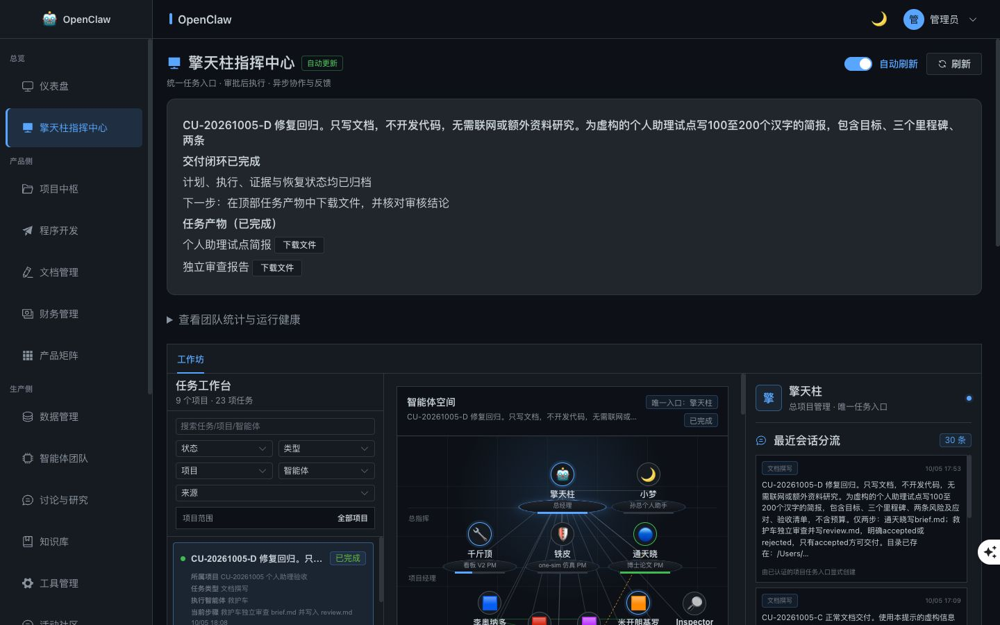

# 首轮缺陷修复与回归记录

日期：2026-10-05。基于 [原始验收报告](REPORT.md) 实施，保留原有工作区变更和 A/B/C 测试现场；未提交 Git、未修改原测试任务的审批合同或数据库状态。

## 已实施的变化

|问题|修复|验证|
|---|---|---|
|解析失败生成错误基线计划|实际规划入口停止使用回退模板，转为等待反馈；空计划、不可解析输出、仅含审批的计划均不能保存为可批准计划|隔离回归覆盖三种失败输出|
|文档目标被项目类型覆盖|明确纯文档且禁止代码变更时选择文档流程；质检阻止后端/前端等实施步骤|软件项目中的纯文档约束回归通过|
|退回内容不生效|保留原有反馈传递链，取消会丢失反馈的模板回退；补充文档规划、汉字统计、原生工具适用说明|D 的 V1 退回后，V2 真实纠正两项要求|
|未知副作用直接要求删除|新产生的 unknown 效果只生成 verify_effect 只读核实合同；必须审批；核实结果只有 not_needed 可解阻，声称 reverted 不能通过|合同与完整审批状态机回归通过；未改变旧 B 的冻结合同|
|回执幂等键错误|执行回复示例直接填入该步骤的实际合同键，保留原有严格相等校验，禁止替代键|D 写作步骤首次执行通过，正确使用 plan:2:step:1|
|字数与文档工具证据|规划和执行明确区分字节/字符/汉字；文档能力识别支持真实 Markdown 文件和审核文档，仍保留文件完整性检查|D brief.md 实测160汉字、229 Unicode字符、567字节；审核复核一致|
|项目保存结果不清楚|创建请求允许初始化耗时；阻止重复点击；工作区初始化失败返回已创建项目和明确警告，不删除已落库项目|界面创建“CU-20261005 保存回归”后表单关闭、列表直接可见；初始化失败独立回归通过|
|难以看到当前任务和结果|当前任务、阻塞原因、下一步、审批/反馈定位与文件下载置顶；统计/健康默认折叠；未最终验收的产物明确标记|桌面/移动实际检查；C 文件从界面下载成功并验哈希|
|局部证据通过被当作完成|未完成所有步骤或有证据警告时，证据阶段不显示已完成；顶层显示具体副作用阻断原因；新失败事件包含步骤原因|生命周期回归和 C 界面检查通过|
|草稿丢失/项目悄悄改变|会话内保存草稿、模式和项目；切换模式后不兼容的项目清空并提示重新选择|刷新保持 D 草稿与项目；模式切换保留文字、清空项目、禁用提交|

## 自动验证

- 后端76项通过，覆盖任务状态机、补偿、计划退回、文档合同、执行证据和新增回归，见 [测试输出](repair-backend-tests.txt)。
- 前端2个测试文件、7项通过：CommandCenterGovernance、commandCenterLifecycle。
- 前端类型检查与生产构建通过，见 [构建输出](repair-frontend-build.txt)。构建保留现有大体积文件提示；未以此作为功能通过依据。
- `git diff --check` 通过。
- 下载服务限制在已授权任务登记的产物、允许的交付目录、5MB以内、SHA256匹配的文件。默认目录为仓库 docs/review；其他部署可配置 COMMAND_CENTER_ARTIFACT_ROOTS。不接受符号链接，也不自动开放整个文件系统。

## 实际回归任务 D

任务：`mission-71a1b4d4379a`，项目 `proj-b64156d740`。使用虚构数据，仅授权 D/brief.md 与 D/review.md。

1. 填写需求后刷新，草稿与项目保持，随后通过主页提交。
2. V1 有两项不准确要求：wc -m被当作汉字计数、文档写作被要求使用代码开发工具。通过前端退回，要求保留范围并纠正。
3. V2 改用 Python 汉字统计和原生文件工具，保留独立审核、仅 accepted 可交付。前端批准后开始执行。
4. 通天晓首次执行完成；合同键准确，副作用门禁通过，没有补偿项；救护车独立读取后输出 accepted 审核报告。
5. 最终系统状态与下载核验见本报告下方的最终核验记录；不把文件存在直接等同于任务完成。

文件：[简报](deliverables/D/brief.md)、[独立审核](deliverables/D/review.md)。简报 SHA256：`508dad1f46a616091868a2325df3622f2e9b76f8333926d44f4853f93d85a259`。

## 证据与边界

- [草稿恢复](25-draft-retained-dom.txt)、[D V1](26-D-plan-v1-dom.txt)、[D V2](27-D-plan-v2-dom.txt)、[项目保存成功](28-project-save-fixed-dom.txt)、[模式切换保护](30-mode-protection-dom.txt)。
- C 的新增下载入口实际返回200，本机 Downloads/brief.md 与原文件同为935字节、SHA256一致。浏览器自动化的 download 事件等待超时，因此额外通过实际落盘文件核验，不能将事件超时误报为下载失败。
- B/C 的旧补偿合同未被自动重写或批准，没有执行删除。新只读恢复合同已通过隔离测试；旧任务恢复需要新审批流程或人工审阅，不能靠后台修改历史记录伪造成功。
- 语义质检增加的是明确文档/禁止代码的确定性保护，不代表能自动理解所有自然语言限制。D 的第一次计划仍需人工纠正，说明批准前审阅仍然必要。
- test_runner 对非标准证据类型的识别仍可能警告。没有关闭证据门禁或伪造工具名称以获得全绿结果。
- 项目保存已覆盖正常路径与初始化失败提示；跨标签并发创建、进程中断时的幂等恢复、跨设备草稿同步未在本轮实现。
- 本轮是一条完整业务链的回归，尚不能替代原报告建议的连续多轮稳定性和故障注入验收。

## 最终核验记录

- D 的最终状态为 **completed**，计划版本V2，两个步骤各执行1次均为completed，独立审核为accepted；见 [数据库快照](repair-database-evidence.json) 与 [最终界面](31-D-completed-dom.txt)。
- 简报和审核报告都已从界面实际下载；下载副本与交付目录文件的SHA256逐一一致，见 [文件核验记录](repair-file-verification.json)。审核文件SHA256为 `4575505d918d53c04a63e54e9581f4ce83344c712f37f88a1bf457e013ba4dff`。
- 写作与审核的历史证据评分仍有警告：test_runner分类未命中；审核另有outcome证据名称不匹配和document_workspace识别警告。最后一项的识别规则已补充并通过回归，但没有改写历史评分。本轮不能宣称严格证据模式下所有门禁零警告。
- 所有正在执行的步骤结束后，API与专用执行器均重启加载最终代码；界面显示2/2在线、0过期租约，见 [最终健康状态](33-final-health-dom.txt)。
- 最终回归：后端76项、前端7项通过；前端构建及差异格式检查通过。源码文件校验见 [修复版本清单](repair-source-manifest.json)。

结论：本轮核心修复和一次完整交付回归完成；连续多轮稳定性、旧任务恢复与故障注入仍按原报告作为后续验收，未计为通过。
