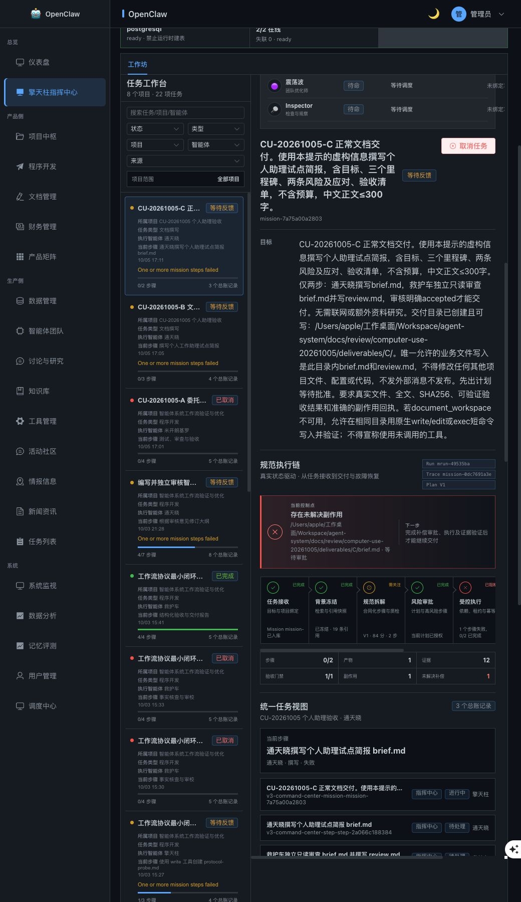

# Agent-system Computer Use 首轮验收报告

测试日期：2026-10-05（Asia/Shanghai）  
结论：**Computer Use 测试可行；本轮个人助理交付闭环未通过验收。** 已真实操作项目创建、任务委托、计划退回、批准、取消、反馈、刷新恢复和结果查找。发现阻断后保留现场，不将尚未执行的审核、补偿及交付记为通过。

## 1. 范围与证据口径

- 本地应用：`http://127.0.0.1:3021`；Edge；桌面 1440×900、移动视口 390×844。
- 操作方式：Computer Use 浏览器界面；数据库、源文件与交付文件仅用于只读核验，不通过后台接口伪造 UI 操作或修改任务状态。
- 源码 HEAD：`bb419705dec4a0a6de25a403dc25fe29d0f86b56`。工作区已有未提交修改，因此 HEAD 不单独代表测试版本；见 [源码差异摘要](source-diff-stat.txt)。本轮未修改业务源码。
- 新建项目：`proj-b64156d740`，名称 `CU-20261005 个人助理验收`。使用虚构内容；业务写入限于本轮交付目录。
- C 的空目录由测试人员预先建立，作为正常路径前置条件；简报由应用智能体实际生成。B 的目录保持不存在，用于缺失前置条件场景。
- 原始事实：[数据库快照](database-evidence.json)、[文件核验](file-verification.json)、本目录 DOM 文本和截图。测试数据保留，未清理 B/C 现场。
- 这是首轮执行报告，不是全系统通过证明。未执行生产故障注入、外部消息发送、真实财务操作、压力和长期稳定性测试。

## 2. 三条实际任务链

|任务|实际操作|最终状态|结论|
|---|---|---|---|
|A `mission-3c989b967099`|在软件项目提出纯文档需求；检查 V1；退回并明确删预算、补两条风险、禁止代码；检查 V2；取消|cancelled，V2|两版均变为软件基线计划，质检100；需求纠正失败。审批前未执行，取消成功|
|B `mission-1f9c2f0212bf`|文档入口提交；批准三步计划；执行遇到目录不存在；提交恢复反馈|waiting_feedback，V1|第一步 blocked，无产物；后两步未执行。系统将未报告副作用合成为 unknown 并要求删除不存在的文件，恢复未闭环|
|C `mission-7a75a00a2803`|预建空目录；提交两步文档计划；批准；核对文件和刷新后状态|waiting_feedback，V1|brief.md 真实生成且哈希一致；副作用幂等键不合合同导致第一步失败，独立审核未启动，review.md 不存在|

**本轮新任务中，完整交付成功为 0。** A 是主动取消的负向用例，B 是前置条件缺失用例，C 是正常路径尝试，不应合并计算“生成成功率”。

## 3. 检查项结果

“部分”表示子行为有通过也有失败；“阻塞”表示未达到可验证的终点。

|编号|检查项|结果|实际证据或限制|
|---|---|---|---|
|T01|项目入口可发现性|部分|项目中枢/程序开发未见创建按钮；文档管理存在“新建项目”|
|T02|项目保存反馈与重复提交|失败|保存后表单仍在，重试409；刷新后项目存在，无法清楚判断首次保存结果|
|T03|空白任务提交限制|通过|空输入提交按钮禁用|
|T04|模式切换保留草稿|通过|输入内容保留|
|T05|模式切换项目绑定可理解性|失败|默认项目随模式切换改变；文档模式排除软件项目，混合业务需要额外入口|
|T06|刷新保留未提交草稿|失败|草稿丢失，模式/项目重置；这是本轮用户体验验收要求|
|T07|文档入口正确创建与定位任务|通过|B/C 创建为 document，并跳转带 mission_id 的任务页|
|T08|未批准不得启动执行|通过|A 未批准阶段无执行记录；B/C 明确批准后启动|
|T09|计划符合目标及限制|失败|A 纯文档目标被软件基线替代并得100分|
|T10|退回理由生效|失败|A 反馈入事件记录，但 V2 仍是相同软件基线|
|T11|取消与持久化|通过|A 数据库最终 cancelled、approval_status cancelled|
|T12|文档计划角色与依赖|通过|B 三步、C 两步，写作与独立审核分别分配|
|T13|计划质量提示适配任务|失败|B/C 虚构且自包含，仍因没有资料研究扣分并警告|
|T14|缺失前置条件不得虚报完成|通过|B blocked，无文件，后续审核未执行|
|T15|无落地效果的恢复体验|失败|B unknown 副作用进入删除补偿流程|
|T16|反馈记录与继续执行|部分|CU-RECOVER-01 已记录，但仍被补偿阻断|
|T17|正常写作生成真实文件|通过|C brief.md 存在，内容四部分齐全，哈希匹配|
|T18|执行回执与合同匹配|失败|C idempotency_key 缺少计划版本，门禁拒绝|
|T19|字数证据准确|失败|C 报告 wc -m 为935；独立核验935是字节数，Unicode字符393，汉字242（含标题）|
|T20|独立审核与accepted交付|阻塞|C 审核步骤 attempt_count=0，review.md 不存在|
|T21|刷新保持任务定位与状态|通过|B/C 保持 mission_id；C 刷新后仍显示真实阻塞|
|T22|已完成任务可直接获取结果|失败|历史已完成任务显示产物数量，但所检查任务详情无直接打开/下载控件|
|T23|状态呈现与下一步可理解性|失败|证据验收“已完成/通过”与执行失败同时出现；主要错误是泛化英文|
|T24|桌面与移动首屏任务优先级|失败|统计、生产门禁及团队信息占据主要空间；移动首屏看不到当前任务决策|
|T25|相关现有前端自动测试|通过|两文件共5项通过；不代表上述真实执行链通过|
|T26|补偿实际执行及恢复幂等性|阻塞|B 的批准操作被自动审批审查拒绝，未执行；C 保留原始文件现场|
|T27|断网/服务重启/租约接管/并发重复操作|未执行|本轮优先发现与核验核心阻断，未对共享运行环境注入故障|

## 4. 可复现缺陷与修复验收标准

### F01 — P0：语义错误的回退计划被评为100分，退回后仍不纠正

复现：A 在软件项目明确提出只写文档、不开发代码 → V1 为架构/后端/前端/测试四步 → 退回并指定文档流程与变更 → V2 重复软件基线。

数据库 rationale 明确记录“规划模型未返回可解析结构，采用受控的软件开发基线计划”。这是解析失败后的回退，不是模型正确理解了需求。两版 quality 均给100分。A 未获批准，因此本轮没有实际越界写代码；P0 是后续误批准风险与核心意图保护失效的分级。

建议：解析失败显式报错或澄清；项目类型不能覆盖明确任务目标；质检加入目标/禁止事项/退回增量的语义校验。重测要求：两版计划均不得出现代码实施；退回后的预算删除与风险补充必须可见。

证据：[V1](06-plan-v1-dom.txt)、[V2](08-plan-v2-dom.txt)、[规划记录](planning-database-evidence.jsonl)。

### F02 — P1：项目已建立，但保存状态未闭环

复现：文档管理 → 新建项目 → 保存 → 表单未关闭、列表未更新 → 再保存冲突 → 刷新可见项目。已确认409，不将首次请求超时或具体事务原因当成已证实事实。

建议：明确“创建成功/初始化中/初始化失败”状态，失败允许恢复同一项目；重复提交可返回已有结果。重测要求：一次提交一次建项，出现成功提示并进入项目；网络延迟下不诱导重复创建。

证据：[保存响应](09-project-save-response-dom.txt)、[刷新后](10-project-after-reload-dom.txt)。

### F03 — P1：没有产物的阻塞进入删除补偿，缺少核实后恢复路径

B 第一步因目标目录不存在返回 blocked，artifacts/evidence/side_effects 均空。本地也核实 B 目录不存在。系统合成 `unreported-effect`，状态 unknown，并套用删除 brief.md 的补偿合同。

源码 `backend/services/compensation_service.py` 对未报告效果仅在特定传输错误时标记 not_applied，其他情况视为 unknown。保守阻断合理，但需要“只读核实无落地效果→补充前置条件→恢复”的路径，不能让用户只剩潜在删除操作。

重测要求：对“确未写入”“已经写入”“无法确定”分别建例，只有核实结果允许的补偿才可执行；不存在文件不应强制要求删除授权。

证据：[B阻塞](17-B-blocked-dom.txt)、[反馈](18-feedback-dom.txt)、[数据库](database-evidence.json)。

### F04 — P1：真实写入成功，但合同幂等键回传错误导致正常路径阻断

C 预期 `mission-7a75a00a2803:plan:1:step:1`，执行器回传 `mission-7a75a00a2803:plan:step:1`。completion_decision 的唯一 effect blocker 为“副作用 write-brief-md 使用了非合同幂等键”。门禁拦截本身符合规则，问题在执行器未可靠传递合同标识及恢复方式过度依赖删除重建。

建议：稳定标识由执行适配层传递并校验，避免模型重写；保留真实性校验，提供只读核验和回执修复流程，不放宽门禁假装成功。重测要求：首次执行准确回传标识；刷新/反馈/重试不重复写入，独立审核正常启动。

### F05 — P1：交付证据文字与事实不一致

C SHA256 复验一致：`739f02d5c8358a50c97e42a345b34311c1043384ca6341eaceb7db0e7aa545de`。但回执称 wc -m=935，实际UTF-8字节数935、Unicode字符393、汉字242（含标题）。按汉字统计满足300上限，但“约179字”和字数工具证据不足以作为验收事实。

此外计划要求全文证据、document_workspace，实际报告 exec 和摘要，证据门禁只警告。原需求与审批明确允许 exec 回退，计划标准化后仍强制 document_workspace，反映合同与授权范围未对齐。C 最终阻断由 F04 引起，不能误归因为工具警告。

建议：定义可复验的字数口径，存储工具原始结果并核对文件；将允许的工具回退编入合同；全文通过受控产物查看器提供。见 [文件核验](file-verification.json)。

### F06 — P1：状态与实际用户动作脱节

C 展示“证据验收已完成”“门禁1/1”，同时步骤0/2、等待反馈、存在未解决副作用；统一总账条目还出现“待处理”。主要错误信息只写 One or more mission steps failed，真实的幂等键问题不在主控制点解释。用户难以区分局部证据评分与最终交付条件。

建议：顶部统一回答当前状态、具体阻塞、谁来处理、唯一建议动作；局部检查标注“通过但非最终交付”，独立审核未完成不能呈现交付已验收。

证据：[C最终界面](22-C-blocked-dom.txt)、[刷新持久化](23-C-after-refresh-dom.txt)。

### F07 — P1：任务详情缺少直接获取交付物的路径

只读检查历史完成任务 `mission-e6ed0e9b0400`，显示4/4步骤、3份产物、47条证据、5/5门禁，但所检视详情没有产物打开/下载入口；C 也以数量和路径文本为主。此结论限于被测任务详情，不断言所有页面都没有文件功能。

建议：任务结果卡列出文件名、版本、审核结论、预览/下载；过程与原始证据折叠。重测要求：仅凭前端，从完成通知两次点击内打开主交付物并找到审核结论。

证据：[历史完成任务](16-historical-completed-dom.txt)。

### F08 — P2：任务体验被运维信息遮挡，草稿与项目切换缺少保护

桌面与移动视口优先显示统计、连接池、租约和团队状态；移动首屏缺少当前任务和决策。主页刷新丢草稿，模式切换还会改变项目。没有实测耗时或正式可用性访谈，不宣称达到某个用户时间指标。

建议：默认“待我处理→当前任务→结果”，运维移入详情；模式切换提示项目变化并保留草稿。虚构内容任务允许声明不需要研究阶段，消除无关质量警告。

## 5. 尚未完成与后续重测顺序

1. 先修 F01：错误回退和退回无效。用 A 同样提示验证需求、禁止项和变更确实进入计划。
2. 修 F03/F04/F05：回执、幂等键、无效果恢复与证据真实性。B 验证可恢复，C 必须产出 brief.md + review.md，独立审核 accepted 后才结束。
3. 修 F02/F06/F07/F08：项目创建反馈、当前决策、交付查看、草稿保护。随后在桌面和移动视口按同一业务链重测。
4. 核心链稳定后，执行独立审核 rejected→返修→复审、反馈连续修改、重复点击、跨任务隔离、取消运行中任务、断网重连、worker重启、租约接管、补偿失败与重试。故障注入使用可恢复的隔离测试环境。
5. 最终验收建议：至少连续3次不同虚构需求完成“委托→正确计划→审批→真实产出→独立审核→前端可打开结果”；负向用例不越权、不误报完成；阻断有清晰恢复动作。此处是后续验收门槛，不是本轮已达成结果。

## 6. 保留现场及授权阻断

A 已取消；B/C 等待反馈，C brief.md 保留但未独立审核，不能作为最终合格交付。没有删除产物、修改任务数据库或绕过门禁。

**B 的“批准补偿”被自动审批审查拒绝两次**：预定义补偿可能删除 `deliverables/B/brief.md`，与此前“不删除已有文件”的范围冲突；即使当前文件不存在，自动审查仍要求明确授权该删除动作。已向用户提出限定路径的授权问题，未获答复前不执行，也不经后台绕过。C 未尝试批准删除补偿，保留文件用于排查。

## 7. 质量检查与产物索引

- 现有前端检查：`CommandCenterGovernance.spec.ts`、`commandCenterLifecycle.spec.ts`，2文件5项通过，见 [测试输出](frontend-tests.txt)。这些测试不能覆盖本轮实际发现的计划与执行回执问题。
- [C简报（未经独立审核）](deliverables/C/brief.md)
- [结构化缺陷清单](findings.json)
- [原始任务/计划/步骤/事件快照](database-evidence.json)
- [C阻断截图](screenshots/22-C-blocked.jpg)
- [移动首屏截图](screenshots/13-workbench-mobile.jpg)
- [A错误计划V2截图](screenshots/08-wrong-plan-v2.jpg)
- [项目保存反馈截图](screenshots/09-project-save-response.jpg)

